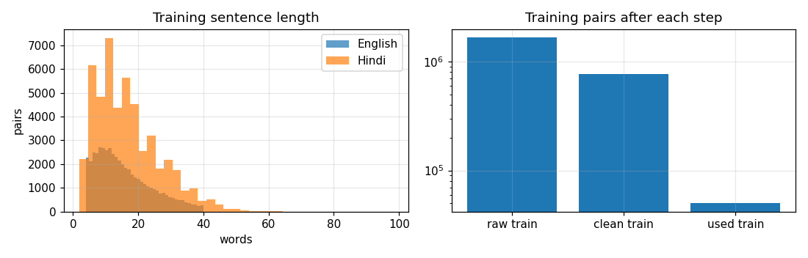
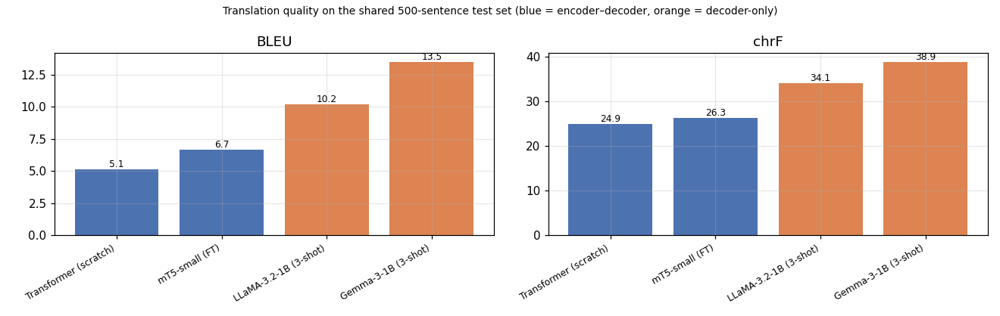
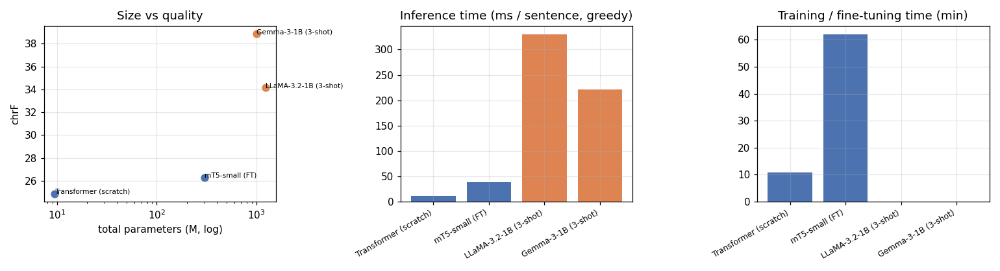
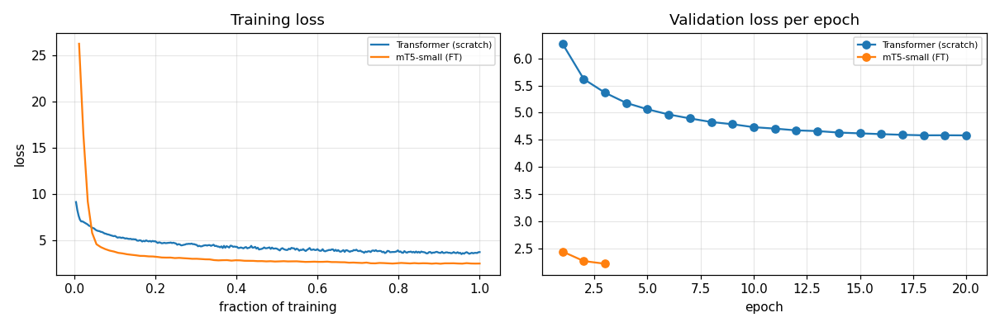
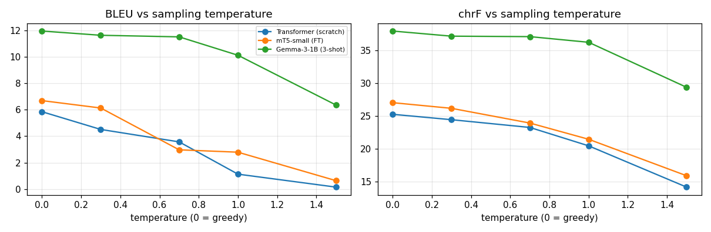
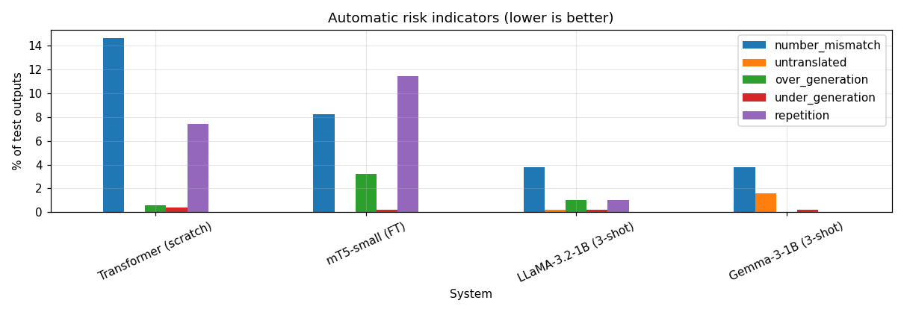

# English → Hindi Machine Translation: Transformer vs mT5 vs LLaMA vs Gemma

**ICT4403 – Foundations of Generative AI · Assignment 3**  
**Student:** Vignesh · **Reg. No.:** 220953668

## 1. Problem statement and objective

Machine translation (MT) between English and Hindi is hard: the two languages use different
scripts (Latin and Devanagari) and different word orders (SVO and SOV), and Hindi marks
grammatical gender on verbs and adjectives. The objective of this project is to build
English→Hindi translation systems with **two architecture families**, evaluate them on the
*same* test set under comparable settings, and compare quality against computational cost:

* **encoder–decoder:** a basic Transformer trained from scratch, and fine-tuned mT5-small;
* **decoder-only:** LLaMA 3.2 1B Instruct and Gemma 3 1B Instruct, adapted by 3-shot
  in-context prompting.

We also examine the outputs for responsible-AI problems (bias, hallucination, cultural
misrepresentation, sensitive content) and propose mitigations.

## 2. Dataset

**IIT Bombay English–Hindi Parallel Corpus** (Kunchukuttan, Mehta & Bhattacharyya, LREC 2018)

* Hugging Face: <https://huggingface.co/datasets/cfilt/iitb-english-hindi>
* Original source: <https://www.cfilt.iitb.ac.in/iitb_parallel/>
* Licence: CC BY-NC 4.0 (research and educational use)

| Split | Raw pairs | After cleaning | Used |
|---|---:|---:|---:|
| train | 1,659,083 | 769,461 | 50,000 random (10,000-pair subset for LoRA) |
| validation | 520 | 502 | 502 |
| test | 2,507 | 2,400 | 500 random (same for every model) |

The training split mixes many sources (government sites, Wikipedia, TED, books,
GNOME/KDE UI strings, a dictionary), so it is noisy. Preprocessing in the notebook:

1. Unicode NFC normalisation; zero-width characters, BOMs and stray `<s>` tags removed;
   curly quotes straightened; whitespace collapsed.
2. Keep a pair only if the English side has 4–40 words, the Hindi/English word ratio is
   0.5–2.5, the Hindi side is ≥ 80 % Devanagari with no mojibake, the English side has
   no Devanagari, and neither side contains URLs, e-mails, code placeholders (`%s`, `{0}`)
   or UI fragments ending in a colon.
3. De-duplicate on the English side and drop any training pair whose English sentence
   appears in the validation or test sets, so the test set never leaks into training.



## 3. Models

| Model | Architecture | Size | Tokenizer | Adaptation |
|---|---|---|---|---|
| Basic Transformer | encoder–decoder, 4+4 layers, d=256, 4 heads, FFN 1024, pre-LN, tied embeddings | 9.4 M | SentencePiece BPE 8k, joint en+hi, trained on our data | trained from scratch, 20 epochs, AdamW + warmup, label smoothing 0.1 |
| mT5-small (`google/mt5-small`) | encoder–decoder (T5) | 300.2 M | 250k multilingual SentencePiece | full fine-tuning, 3 epochs, prefix `translate English to Hindi:` |
| LLaMA 3.2 1B Instruct | decoder-only | 1,235.8 M | 128k byte-level BPE | 3-shot in-context prompting |
| Gemma 3 1B Instruct | decoder-only | 999.9 M | 262k SentencePiece | 3-shot in-context prompting |

LLaMA and Gemma are loaded from the ungated `unsloth/` copies of the official weights
(`meta-llama/Llama-3.2-1B-Instruct`, `google/gemma-3-1b-it`), so no access approval is needed.
They are prompted in their own chat template with three fixed English→Hindi example pairs
taken from the training split, followed by the instruction
*"Translate the following English sentence into Hindi. Reply with only the Hindi translation."*
The notebook also implements LoRA fine-tuning for both (r = 16 on all attention/MLP projections,
loss on the Hindi answer tokens only), but it is switched off (`llm_lora=False`) because it did
not fit the compute and time budget of a free Colab T4; the reported results use prompting.
Every system uses **greedy decoding** with the same 160-token limit on the same 500 test sentences.

## 4. How to run

**Google Colab (what the reported results used)**

1. Open `FGAI_A3_English_Hindi_MT.ipynb` in Colab (*File → Upload notebook*, or *Open in Colab* from GitHub).
2. *Runtime → Change runtime type → T4 GPU*.
3. *Runtime → Run all*. If Google Drive access is granted, results are saved to
   `MyDrive/FGAI_A3_results` after each model, so after a disconnect *Run all* skips finished
   models; otherwise they are kept in `/content/FGAI_A3_results` for the session.
4. When it finishes (≈ 1.5 h on a T4, most of it mT5 fine-tuning), `results.zip` downloads;
   its contents are the `results/` folder of this repository.

**Locally (needs an NVIDIA GPU for the full run)**

```bash
pip install -r requirements.txt
jupyter nbconvert --to notebook --execute FGAI_A3_English_Hindi_MT.ipynb
```

Setting the environment variable `MT_QUICK=1` runs a few-minute CPU smoke test on a tiny
subset; its numbers are meaningless and are not reported.

## Repository layout

```
FGAI_A3_English_Hindi_MT.ipynb   all code: data, 4 models, evaluation, plots, risk analysis
requirements.txt
results/
  metrics.csv / metrics.md       BLEU, chrF, params, train and inference time
  temperature.csv                BLEU / chrF vs sampling temperature
  tokenization.csv               tokens per sentence for each tokenizer
  risk_flags.csv                 automatic responsible-AI indicators
  test_translations.tsv          all 500 test translations from every system
  sample_translations.md         15 test sentences side by side
  probe_translations.md          bias / culture / sensitive-content probe set
  temperature_examples.md        the same sentences at different temperatures
  systems/*.json                 raw per-system outputs, losses and timings
  data/                          the exact train / validation / test splits used
  plots/                         all figures
```

## 5. Results obtained

All numbers come from one run of the notebook on a free Colab **Tesla T4** (see
`results/metrics.csv`, `results/systems/*.json`). Test set: the same 500 sentences for all models,
greedy decoding. BLEU signature `nrefs:1|case:mixed|eff:no|tok:intl|smooth:exp|version:2.6.0`;
chrF signature `nrefs:1|case:mixed|eff:yes|nc:6|nw:0|space:no|version:2.6.0`.

| Model | Architecture | Adaptation | **BLEU** | **chrF** | Parameters | Trainable | Training / fine-tuning time | Inference time (500 sent.) | ms / sentence |
|---|---|---|---:|---:|---:|---:|---:|---:|---:|
| Basic Transformer | encoder–decoder | trained from scratch (50k pairs, 20 epochs) | 5.14 | 24.86 | 9.4 M | 9.4 M | 10.8 min | 5.7 s | 11 |
| mT5-small | encoder–decoder | full fine-tuning (50k pairs, 3 epochs) | 6.69 | 26.28 | 300.2 M | 300.2 M | 62.1 min | 19.2 s | 38 |
| LLaMA 3.2 1B Instruct | decoder-only | 3-shot prompting | 10.22 | 34.14 | 1,235.8 M | 0 | none | 165.2 s | 330 |
| **Gemma 3 1B Instruct** | decoder-only | 3-shot prompting | **13.52** | **38.88** | 999.9 M | 0 | none | 110.4 s | 221 |




Training curves (validation loss): the Transformer fell from 6.27 to 4.58 over 20 epochs and was
still improving slowly; mT5 went 2.44 → 2.26 → 2.21 over its 3 epochs.



Tokenization of the test set (`results/tokenization.csv`):

| Tokenizer | English tokens / sentence | Hindi tokens / sentence | Hindi : English |
|---|---:|---:|---:|
| SentencePiece BPE 8k (Transformer, trained on our data) | 32.2 | 34.6 | 1.07 |
| mT5 (250k multilingual) | 29.9 | 45.5 | 1.53 |
| LLaMA 3.2 (128k) | 23.5 | 58.3 | **2.48** |
| Gemma 3 (262k) | 23.6 | 29.7 | 1.26 |

Side-by-side translations of 15 test sentences are in `results/sample_translations.md`, and all
500 are in `results/test_translations.tsv`.

## 6. Model comparison and evaluation

**Quality.** The two decoder-only LLMs clearly beat the two encoder–decoder models, even though
they saw only three examples and no gradient updates: Gemma reaches BLEU 13.5 / chrF 38.9 and
LLaMA 10.2 / 34.1, against 6.7 / 26.3 for fine-tuned mT5 and 5.1 / 24.9 for the scratch
Transformer. On sample sentences the LLMs keep most of the meaning and named entities, mT5 is
fluent but often drifts and repeats itself, and the Transformer produces grammatical Hindi
that frequently loses the meaning of long news sentences.

**Why — it is not the architecture alone.** The comparison mixes four factors:

* *Pretraining and size.* LLaMA and Gemma have 1.0–1.2 B parameters pretrained on trillions of
  tokens, including Hindi, so prompting only has to tell them the task. mT5-small (300 M) was
  pretrained on multilingual text with a denoising objective, never on translation, and 3 epochs
  on 50k pairs only partly teach it the task. The scratch Transformer (9.4 M) learns Hindi
  only from the 50k training pairs.
* *Domain.* The training pairs come from mixed IITB sources, but the test set is WMT news, which
  hurts the models trained only on that data more than the broadly pretrained LLMs.
* *Tokenization.* LLaMA's tokenizer needs 2.5 Hindi tokens per English token, so a Hindi
  sentence costs it about twice as many decoding steps as Gemma, whose 262k vocabulary covers
  Devanagari well (1.26). This is one reason LLaMA is both slower and weaker than Gemma at a
  similar size. mT5's large multilingual vocabulary also makes its output layer huge: it ran
  out of GPU memory with batch 32 and had to use batch 8 × 4 gradient-accumulation steps.
* *Adaptation method.* mT5 and the Transformer were trained; the LLMs were only prompted.
  LoRA fine-tuning of the LLMs is implemented in the notebook and would be the next step.

**Cost.** The encoder–decoder models are far cheaper to *run*: 11 ms (Transformer) and 38 ms
(mT5) per sentence, against 330 ms (LLaMA, fp16) and 221 ms (Gemma, fp32 because
Gemma 3 overflows in fp16 on a T4). Decoder-only models also re-read the 3-shot prompt for
every sentence. On the other hand, the LLMs needed **no training time**, while mT5 needed
62 minutes of fine-tuning and the Transformer 11 minutes. The LLMs have 100–130× more
parameters than the Transformer and need several GB of GPU memory just for their weights.

## 7. Sampling-temperature analysis

The first 100 test sentences were decoded with pure temperature sampling (`top_k = 0`,
`top_p = 1.0`) at T ∈ {0.3, 0.7, 1.0, 1.5}; T = 0 is greedy (`results/temperature.csv`).
Each cell is BLEU / chrF.

| Model | T = 0 (greedy) | T = 0.3 | T = 0.7 | T = 1.0 | T = 1.5 |
|---|---|---|---|---|---|
| Transformer | 5.85 / 25.23 | 4.51 / 24.41 | 3.57 / 23.23 | 1.13 / 20.43 | 0.15 / 14.15 |
| mT5-small | 6.69 / 27.00 | 6.13 / 26.14 | 2.97 / 23.90 | 2.79 / 21.43 | 0.64 / 15.88 |
| Gemma 3 1B | 11.95 / 37.90 | 11.63 / 37.12 | 11.51 / 37.05 | 10.12 / 36.19 | 6.36 / 29.34 |

For every model quality is highest with greedy decoding and falls as the temperature rises:
translation has essentially one correct meaning, so sampling only adds the chance of picking
a wrong word, and one wrong token early on derails the rest of the sentence. The models differ
in **how fast** they degrade. The small, weakly trained models have flat output distributions,
so T = 0.7 already removes about half of their BLEU, and at T = 1.5 they produce near-random
text. Gemma's distribution is much sharper: up to T = 0.7 it loses less than half a BLEU
point, and only at T = 1.5 does it break down. Greedy or low temperature (T ≤ 0.3) is
therefore the right setting for translation; higher temperatures are only useful to produce
*alternative* translations for a human to choose from. `results/temperature_examples.md`
shows the same sentences at every temperature.



## 8. Responsible and ethical AI

Two kinds of evidence were used: automatic indicators on all 500 test outputs
(`results/risk_flags.csv`), and 20 hand-written probe sentences on gender, facts, idioms, culture
and sensitive content (`results/probe_translations.md`).

| % of test outputs flagged | Transformer | mT5 | LLaMA | Gemma |
|---|---:|---:|---:|---:|
| numbers changed, dropped or invented | 14.6 | 8.2 | 3.8 | 3.8 |
| repeated 3-gram (looping) | 7.4 | 11.4 | 1.0 | 0.0 |
| output > 2× reference length | 0.6 | 3.2 | 1.0 | 0.0 |
| untranslated (> 30 % Latin letters) | 0.0 | 0.0 | 0.2 | 1.6 |



**Gender bias.** Hindi marks the subject's gender on the verb, so the model has to choose it.
For *"The doctor finished **her** shift and went home"* mT5 wrote the masculine *घर आ गया* and the
Transformer the masculine/plural *गये*, turning a woman doctor into a man; LLaMA and Gemma
correctly used the feminine *आ गई / चली गई*. For *"My friend is a pilot and **she** loves flying"*
LLaMA and mT5 both used masculine verbs (*रखता है*, *करता है*), and mT5 also turned the nurse in
*"The nurse said…"* into a *डॉक्टर*. Professions such as doctor and pilot default to male forms,
a bias learned from the training data.

**Hallucinated or changed facts.** *"a profit of 4.7 **million** dollars"* became *4.7 करोड़*
(4.7 crore = 47 million) in both mT5 and LLaMA, a 10× error from a wrong unit conversion; only
Gemma kept *मिलियन*. mT5 repeated *3:45 बजे* four times and dropped *Room 217*, and the
Transformer turned 2023 into *202*. Names were altered: *Priya Raman* became *प्रिय राणा* (mT5).
On the main test set Gemma also invented content, e.g. *"सम्मानजनक और सुरक्षित पर्यटन"*
("respectful and safe tourism"), which is not in the source sentence.

**Safety-critical and sensitive content.** *"Take two 500 mg tablets every 8 hours after food"*
became *"500 ग्राम इलेक्ट्रॉनिक डॉलर"* ("500 grams electronic dollars") in mT5, *"500 मिनट"* in the
Transformer, and *"after **water** … **within** 8 hours"* in LLaMA; any of these could harm a
patient, and only Gemma was correct. *"She … needs support, not judgement"* became *"needs **no**
support"* in the Transformer and *"suffering from **corruption**"* in mT5, reversing a
mental-health message. *"Some newspapers called the **protesters** terrorists"* lost the word
*protesters* in the Transformer and mT5, so the output says the papers called *terrorists*, a
meaning change with real defamation risk. LLaMA and Gemma translated the self-harm helpline
sentence correctly; the two small models did not.

**Cultural misrepresentation.** Idioms were translated literally (*"raining cats and dogs"* →
*"कुत्तों और बिल्लियों की बारिश"*, *"black sheep"* → *"काला-बछड़ा"*), which is meaningless to a Hindi
reader, although Gemma did render *"Break a leg"* as *शुभकामनाएं* ("good wishes"). In
*"Thanksgiving with turkey and pumpkin pie"* Gemma replaced the pie with *पिज़्ज़ा* and both LLMs
wrote *तुर्की* (the country Turkey). The Transformer and mT5 silently **dropped "beef"** from
*"They ordered beef curry"*, while the LLMs kept it; dropping or replacing a culturally sensitive
word is itself a misrepresentation.

**Measures to reduce these risks**

1. *Human review* for medical, legal, safety, news and government text; never publish raw MT
   output in these domains.
2. *Automatic checks* before release: numbers, dates, units and named entities must match the
   source (the number-mismatch check above flags 4–15 % of outputs); flag repetition, very long
   or short outputs and untranslated English words for review.
3. *Gender handling:* keep the gender given by the source pronoun, test with gender-swapped probe
   sets, and offer both masculine and feminine forms when the source is ambiguous.
4. *Better data and evaluation:* in-domain, balanced training data; glossaries for idioms, units
   (million vs crore) and sensitive terms; evaluation by bilingual native speakers, not only
   BLEU/chrF, which cannot see a flipped negation or a wrong gender.
5. *Decoding and transparency:* use greedy or low-temperature decoding, label output as
   machine-translated, document known failure cases (as this README does), and protect the
   privacy of the text users submit.

## 9. Conclusion

**Gemma 3 1B Instruct with 3-shot prompting is the best-performing model** in this study
(BLEU 13.52, chrF 38.88), followed by LLaMA 3.2 1B (10.22 / 34.14), fine-tuned mT5-small
(6.69 / 26.28) and the scratch Transformer (5.14 / 24.86). It was also the most robust in the
responsible-AI checks: the fewest number errors (3.8 %), no repetition, and the only model that
got the medical, mental-health and "million" probes right. Its advantage comes from large-scale
multilingual pretraining and an efficient Hindi tokenizer rather than from the decoder-only
design alone, and it costs about 20× more inference time per sentence than the small
encoder–decoder models. When compute is very limited, mT5 or the Transformer translate much
faster, but they need training and far more care before use. No model is reliable enough for
unreviewed use on sensitive text.
